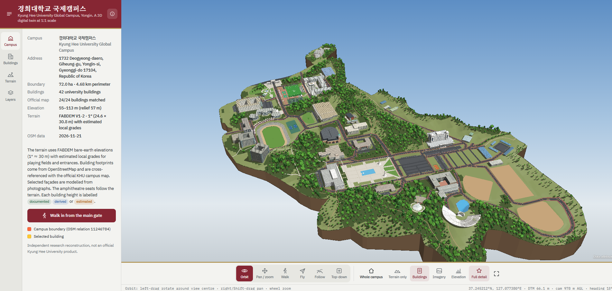

# Kyung Hee University Global Campus: geospatial 3D digital twin

An interactive, geographically referenced 3D reconstruction of **Kyung Hee University Global Campus**
(경희대학교 국제캠퍼스, 1732 Deogyeong-daero, Giheung-gu, Yongin-si). It is a static website built on
[CesiumJS](https://cesium.com/platform/cesiumjs/) and ready to deploy on GitHub Pages. No server, build step
or API key is needed.

**Priorities:** geographic correctness first, completeness second, visual realism third.
Every geometric value in the scene comes from a real dataset, and every value that is estimated or
stylised is labelled as such in the UI and in the machine-readable accuracy report.

## Purpose: education and research

This project is made for **educational and research purposes**. It is an open, reproducible starting
point for building a **campus digital twin**. Students, teachers and researchers can study, reuse and
extend it, for example to:

- **Teach geospatial methods:** terrain models (DTM vs DSM), vertical datums and geoids, coordinate
  systems (WGS84 / EPSG:5186), OpenStreetMap data, and how to label data quality and provenance.
- **Build a fuller digital twin:** add indoor floor plans, rooms and accessibility routes; connect live
  sensor feeds (energy, temperature, air quality, occupancy, parking); or link facility-management records
  to buildings.
- **Plan and simulate the campus:** study sunlight and shadows, line-of-sight and views, walking and
  wheelchair routes on the real slopes, shuttle-bus and traffic flows, emergency evacuation, and the
  impact of new buildings or landscaping.
- **Study the environment:** stormwater and flood paths over the terrain, tree canopy and heat-island
  mapping, noise, and solar-panel potential on roofs.
- **Navigate and engage:** virtual campus tours for new students and visitors, wayfinding, event and
  open-day maps, and AR/VR experiences built on the same geometry.
- **Practise reconstruction:** photo-based 3D modelling (as documented in
  [docs/MODEL_PROGRESS.md](docs/MODEL_PROGRESS.md)), photogrammetry or LiDAR comparison, and
  accuracy assessment against surveyed data.

Use is **non-commercial**. The FABDEM terrain licence (CC BY-NC-SA 4.0) and the terms of the other data
sources apply; see [Data sources and licences](#data-sources-and-licences). This is an independent
reconstruction, not an official Kyung Hee University product, and it is not survey-grade. Do not use it
for engineering, legal or safety decisions.

|                 |                                                                                                                                    |
| --------------- | ---------------------------------------------------------------------------------------------------------------------------------- |
| Campus boundary | OpenStreetMap relation [11246784](https://www.openstreetmap.org/relation/11246784): 2 parts, 72.0 ha, 4.68 km perimeter             |
| Terrain         | FABDEM V1-2 bare-earth DTM, 1″ (≈24.6 × 30.9 m), EGM2008 → WGS84 ellipsoid, **1:1 scale, no exaggeration**               |
| Campus relief   | 55.5–112.9 m (57 m) inside the boundary                                                                                           |
| Buildings       | 41 individually modelled inside the campus, 1,104 including a ~600 m context ring; 24/24 official KHU map building entries matched |
| Coordinates     | WGS84 (EPSG:4326); EPSG:5186 readouts checked against PROJ (max difference 0.002 mm)                                               |

## Features

- **Real terrain** streamed from a 466 KB static grid through `CustomHeightmapTerrainProvider`, in
  realistic, elevation-coloured, slope, contour (1–20 m) and wireframe modes, plus hillshade. The scene
  is a **bounded diorama**: the globe is cut to the campus plus ~600 m, with earth-coloured side walls.
- **Kyung Hee buildings** stand on their real OSM footprints and DTM ground. They carry coloured,
  **stylised** façades (window grid per estimated storey, granite plinth, cornice, parapet), and three
  buildings get special models:
  - the **main gate (정문)**, an illustrative model on the footprint's real frame (59.2 × 5.5 m) with the
    11.3 m drive-through opening taken from the mapped footprint vertices;
  - the **평화노천극장 amphitheatre**, with 41 seating terraces sliced from the real DTM slope;
  - the **천문대 observatory**, with a dome on its circular footprint.
    Surrounding buildings are plain LOD1 masses.
- **Roads, footways, steps, parking, landcover and POIs** (OSM) are draped on the terrain. Vegetation
  instances are placed using OSM woods and a canopy-height model (Copernicus DSM − FABDEM). They are
  labelled as a visual approximation.
- **Navigation**: orbit, pan/zoom, first-person **walk** (eye height 1.7 m above the DTM; building
  footprints block you; *Walk the campus* starts outside the main gate), fly-through, terrain-following,
  top-down, reset, and focus-on-building. The camera can never go below the terrain or leave the diorama.
  Touch devices get an on-screen movement pad.
- **Building information**: Korean/English names (where verified), official campus-map number, OSM id,
  WGS84 and EPSG:5186 coordinates, ground elevation, footprint area, height with its
  documented/derived/estimated status, source and confidence. Search covers names, numbers and ids, and
  deep links use `#b=way/474085534`.
- Sun position and time of day with shadows, and a **Data & accuracy** dialog.

## Run locally

```bash
python -m http.server 8000 --directory web
# open http://localhost:8000/
```

## Deploy to GitHub Pages

1. Create a repository and push this folder to the `main` branch:
   ```bash
   git init && git add . && git commit -m "KHU Global Campus digital twin"
   git branch -M main
   git remote add origin https://github.com/USERNAME/REPOSITORY.git
   git push -u origin main
   ```
2. On GitHub, go to **Settings → Pages → Build and deployment → Source** and choose **GitHub Actions**.
3. The included workflow [`.github/workflows/pages.yml`](.github/workflows/pages.yml) publishes `web/`
   as-is. The site appears at `https://USERNAME.github.io/REPOSITORY/`.

All asset URLs are relative, so the site works under any sub-path. This was checked by serving the
repository root and opening `/web/`. If you would rather not use Actions, copy the contents of `web/`
into a `docs/` folder and choose *Deploy from a branch → /docs*. `web/.nojekyll` is already present.

The published site is 5.4 MB. CesiumJS 1.123.0 is loaded from jsDelivr, and imagery tiles are streamed
from their providers.

## Data pipeline (reproducible)

```bash
pip install -r requirements.txt
python scripts/run_all.py            # downloads ~80 MB of raw data once into data/raw/ (git-ignored)
python scripts/run_all.py --offline  # rebuild web/data from data/raw only
python scripts/check_site.py         # optional: browser checks + screenshots (serve web/ on :8765 first)
```

| Step                                                                                                            | Script                      | Output                                                                             |
| --------------------------------------------------------------------------------------------------------------- | --------------------------- | ---------------------------------------------------------------------------------- |
| OSM acquisition (campus relation + ~600 m buffer)                                                               | `fetch_osm.py`            | `data/raw/osm_overpass.json`                                                     |
| DEM acquisition (FABDEM tile pulled out of the 640 MB zip with HTTP range requests; Copernicus GLO-30 from AWS) | `fetch_dem.py`            | `data/raw/*.tif`                                                                 |
| Terrain grid, EGM2008 geoid grid (PROJ), slope + hillshade overlays                                             | `build_terrain.py`        | `web/data/terrain/`                                                              |
| Buildings, roads, landcover, POIs, vegetation                                                                   | `build_features.py`       | `web/data/*.geojson`, `trees.bin`                                              |
| Gate frame, amphitheatre terraces, observatory                                                                  | `build_campus_details.py` | `web/data/campus_details.json`                                                   |
| Validation, provenance, accuracy report                                                                         | `validate.py`             | `web/data/summary.json`, `web/data/accuracy_report.json`, `docs/ACCURACY.md` |

**Adding documented heights:** Most campus building heights are estimated from photographs or footprint
size. Kyung Hee University publishes the floor counts for Woojungwon and Second Dormitory A and B.
Documented heights from the 건축물대장 building register or VWorld can be added with their source to
[`scripts/height_overrides.json`](scripts/height_overrides.json). Rebuild with `python scripts/run_all.py --offline`.

## Data sources and licences

| Dataset                                                                                                | Use                                                  | Licence                                                                                                                      |
| ------------------------------------------------------------------------------------------------------ | ---------------------------------------------------- | ---------------------------------------------------------------------------------------------------------------------------- |
| [FABDEM V1-2](https://data.bris.ac.uk/data/dataset/s5hqmjcdj8yo2ibzi9b4ew3sn) (Hawker et al. 2022)      | Bare-earth terrain                                   | **CC BY-NC-SA 4.0**: the derived terrain files in `web/data/terrain/` inherit this, so the project is non-commercial |
| [Copernicus DEM GLO-30](https://registry.opendata.aws/copernicus-dem/)                                  | DSM cross-checks, canopy model                       | Copernicus DEM licence (free, attribution)                                                                                   |
| [OpenStreetMap](https://www.openstreetmap.org/copyright)                                                | Boundary, footprints, roads, landcover, POIs         | ODbL 1.0 (© OpenStreetMap contributors)                                                                                     |
| [KHU campus map list](https://www.khu.ac.kr/kor/user/contents/view.do?menuNo=200086)                    | Official building names and numbers (verification)   | © Kyung Hee University                                                                                                      |
| EGM2008 via PROJ                                                                                       | Vertical datum conversion                            | Public domain                                                                                                                |
| Esri World Imagery (default), EOX Sentinel-2 cloudless (CC BY-NC-SA), OSM tiles, VWorld (optional key) | Display texture only, streamed and not redistributed | Provider terms                                                                                                               |

**VWorld:** you can paste a key in *Terrain → Imagery → VWorld* (it is stored only in your browser) or
set `vworldKey` in `web/js/config.js`. VWorld keys are tied to a domain, so register
`https://USERNAME.github.io` when you request one. A browser key is public by nature; the domain
restriction is what protects it.

## Accuracy summary

Full details are in [`docs/ACCURACY.md`](docs/ACCURACY.md) and in `web/data/accuracy_report.json`, which
holds a per-feature record of source, measured/estimated status, date and missing information.

- **Vertical**: the DTM vs mapped peak elevations (매미산, 아람산, 독침산) gives a mean Δ of −2.2 m and a
  max |Δ| of 3.5 m. The 30 m posting underestimates summits, as expected. Copernicus GLO-30 is specified
  at < 4 m absolute vertical error (LE90). This is **not** survey-grade terrain, and features narrower
  than ~30 m (retaining walls, stairs, building platforms) are smoothed out.
- **Local grades** model the artificial turf, southern sports ground, baseball fields, stadium bowl and
  entrance aprons using mapped outlines, site references and FABDEM heights. The viewer identifies these
  adjustments as estimates. The [NGII DEM catalog](https://www.data.go.kr/data/15059920/fileData.do) lists
  the official Korean product. A campus DEM export was unavailable for this revision.
- **Vertical datum**: the EGM2008 geoid undulation (N = 23.34–23.79 m) is added explicitly. The UI shows
  orthometric heights.
- **Horizontal**: DEM registration is PixelIsPoint, handled exactly. OSM footprint accuracy is not
  quantified (typically 1–5 m), but footprints line up visually with aerial imagery in top-down views.
- **Building heights**: on campus, the Main Gate height is documented and 40 heights are estimated.
  A DSM−DTM height estimator was tested against 160 documented heights and **rejected**
  (bias ≈ −45 m).
- **Stylised content**: façades, colours, the main-gate form and heights, and vegetation positions are
  illustrative. This is stated in the UI and in the report.

## Project layout

```
web/                 static site (published)
  index.html, css/, js/  main.js, terrain.js, layers.js, khu_buildings.js, camera.js, geo.js, config.js
  data/              generated GeoJSON, terrain grid, overlays, reports
scripts/             offline pipeline (Python) + browser check
docs/                ACCURACY.md, screenshots/
.github/workflows/   GitHub Pages deployment
```

*Independent research reconstruction, not an official Kyung Hee University product.*
